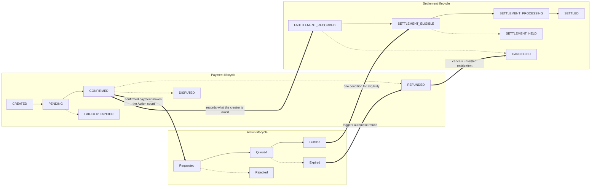
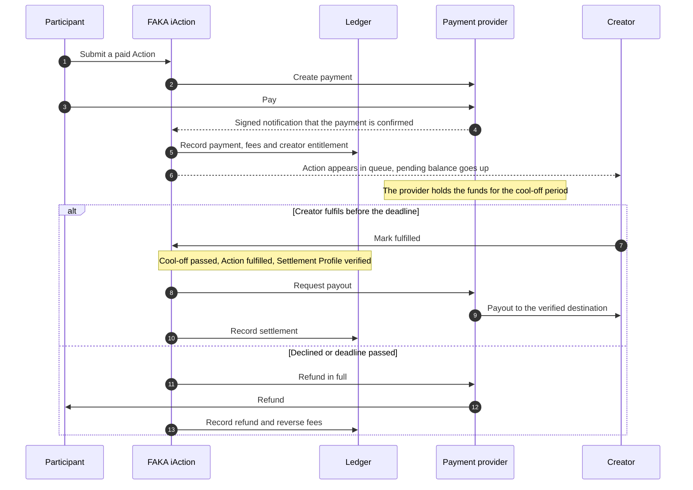
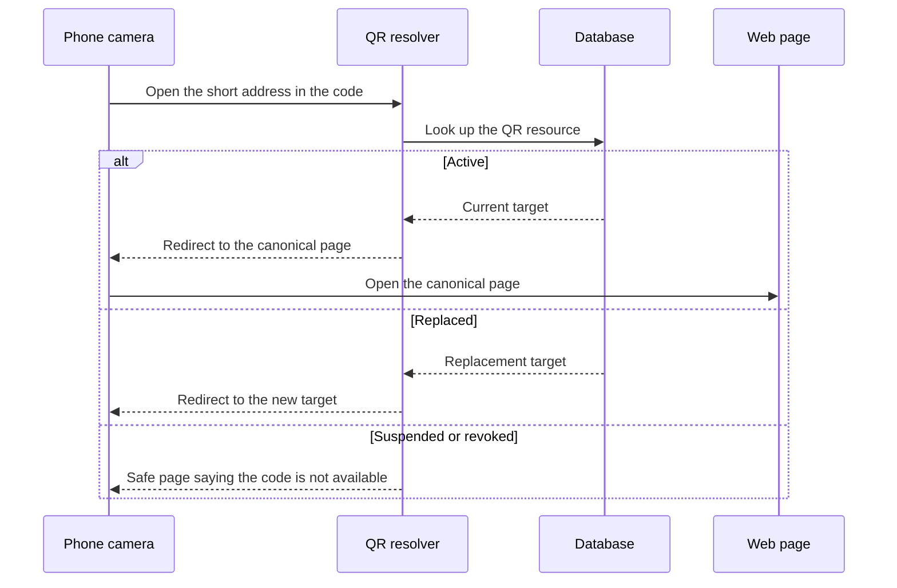
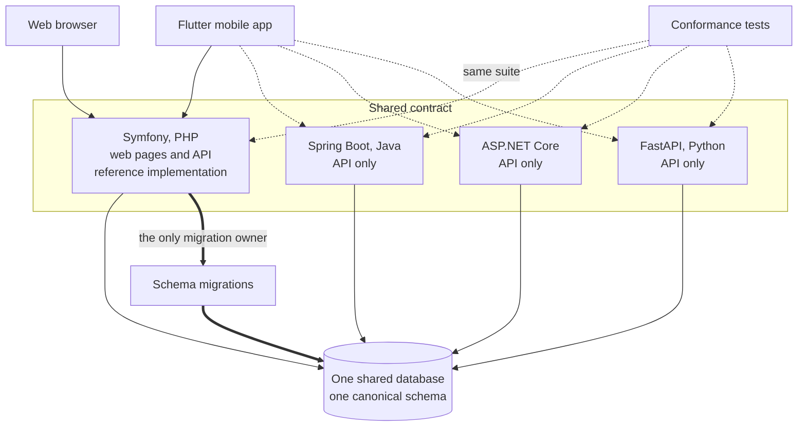
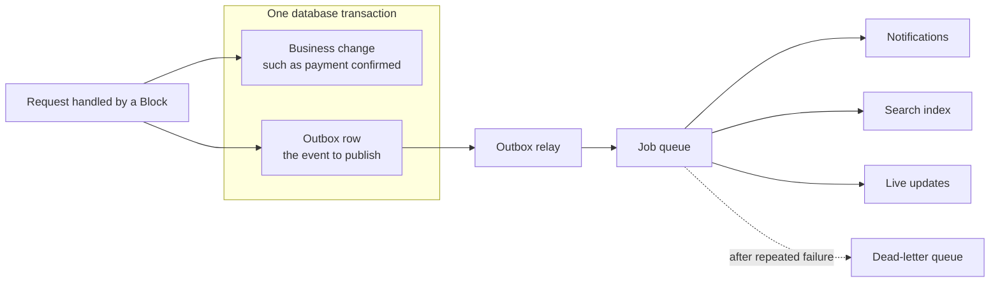

# FAKA iAction architecture overview

**Status:** design documentation. This page describes an approved design (architecture baseline 2.9). Nothing described here is built yet. Where the text says "is" or "does", read it as "is designed to". The [roadmap](https://github.com/Faka-iAction/docs-public/blob/main/ROADMAP.md) in the documentation repository shows what is in progress.

This page is for an engineer who has not seen the project before. It explains what the platform is, the terms it uses, and the main mechanisms. It does not include production configuration, commercial terms or risk rules. Those are kept private by design.

## Contents

1. [What the platform is](#1-what-the-platform-is)
2. [What it is not](#2-what-it-is-not)
3. [Names: company, platform, vertical](#3-names-company-platform-vertical)
4. [Members, guests and creators](#4-members-guests-and-creators)
5. [Creator Actions](#5-creator-actions)
6. [Three separate lifecycles](#6-three-separate-lifecycles)
7. [Money: a non-custodial ledger and no wallet](#7-money-a-non-custodial-ledger-and-no-wallet)
8. [QR codes and short identifiers](#8-qr-codes-and-short-identifiers)
9. [One database, four backends, one migration owner](#9-one-database-four-backends-one-migration-owner)
10. [Contract-first development](#10-contract-first-development)
11. [Web and mobile clients](#11-web-and-mobile-clients)
12. [Events and the outbox](#12-events-and-the-outbox)
13. [What is deliberately left out of this page](#13-what-is-deliberately-left-out-of-this-page)

## 1. What the platform is

FAKA iAction is an interaction platform. A creator publishes a small set of things an audience can do, such as request a song or send a tip. An audience member reaches one of those things by scanning a QR code or opening a link, takes part, pays if the creator set a price, and the creator receives the result.

The short form of the flow is: **scan → interact → pay → outcome**.

The first release is aimed at DJs, musicians and radio presenters in South Africa. The design is not specific to music. The same mechanisms are meant to serve podcasters, streamers, educators and other creators later, without replacing the foundations.

Two principles shape the design:

- **Architecture defines reusable capabilities.** Which audience is served first is a product choice, not something the code hard-wires.
- **The first release sets contracts and foundations.** Later releases add capabilities. They do not replace the foundations.

## 2. What it is not

FAKA iAction does not:

- host livestream video, or replace video and streaming platforms. It works alongside them;
- require an audience member to install an app before taking part;
- require a visitor to register before taking part;
- require a registered member to become a creator;
- hold money in a wallet for anyone (see section 7);
- depend on one programming language for its backend (see section 9).

## 3. Names: company, platform, vertical

The project uses three levels of name. They are not interchangeable.

| Level | Name | Meaning |
|---|---|---|
| Company | Faka Action | The intended owner of the project. |
| Platform | **FAKA iAction** | The whole platform: shared identity, QR codes, Actions, payments, ledger, events and API. |
| Vertical | **FAKA iRequest** | One product on the platform, focused on request-style interactions such as song requests. |

A **vertical** is a product built on the platform for one kind of use. FAKA iRequest is the first vertical. It is not a name for the platform. Other verticals may follow.

Repositories, APIs and shared infrastructure are named after the platform, never after a vertical.

## 4. Members, guests and creators

**Member.** Any registered account is a FAKA Member. There is one identity model. A member is not permanently classed as a fan or a creator.

**Capabilities.** What a member can do is decided by capabilities attached to the account, not by an account type field. Every member has fan capabilities: discover creators, follow them, take part in Actions and see their own history. A member can add the creator extension, which brings a creator profile, Creator Actions, earnings views and analytics. One person can be both audience and creator with one login. A member has at most one creator profile.

**Sign-in.** A member can register and sign in with an email address, with a phone number, or through a social login. A guest needs none of these to take part.

**Fan Mode and Creator Mode.** These are two views of the same account. A member with creator capability can switch between them. Identity and sign-in are shared.

**Guest.** A guest is a participant with no account. Guest participation is a core part of the first release: where the creator allows it, a visitor can take part and pay without registering. Taking part never creates an account silently. Registration can be offered afterwards, and it must be an explicit choice.

On the server, a guest is represented by an explicit guest principal with a narrow set of permissions. A **principal** is the identity a request acts as. Being a guest does not bypass any Action or payment rule.

**Recipient.** The data model and contracts use **Recipient** as the generic term for whoever an Action is addressed to. A creator is one kind of Recipient, and the only kind in the first release. This leaves room for other kinds later without renaming the model.

## 5. Creator Actions

A **Creator Action** is a configurable interaction that a creator publishes. It is the platform's main extension point. The platform does not build a separate application flow for each kind of interaction. It has one Action model with a type and a configuration.

The first release (called MVP1) has five Action types:

| Type | Meaning | Example |
|---|---|---|
| **Request** | "I choose." The participant picks something the creator has made available. | Pick a song from a DJ's playlist. |
| **Vote** | "We choose." The audience picks among options the creator defined. Votes are free in MVP1. A vote cannot be changed once it is submitted. | Vote for the next song. |
| **Bid** | "I want priority and I will pay for it." A paid offer for priority, ranked against other bids. | Offer an amount to move a request up the queue. |
| **Shout-out** | The participant sends a message for the creator to read out, display or deliver. | A birthday message read on air. |
| **Tip** | "Thank you." A voluntary amount with nothing owed in return. | A tip after a set. |

Each Creator Action carries configuration that depends on its type: title, description, price, options or content source, start and end time, whether the creator must approve entries, whether guests may take part, duplicate and quantity limits, moderation rules, and a fulfilment deadline. A **fulfilment deadline** is the time by which the creator must deliver a paid Action.

There are two things here that are easy to confuse:

- The **Creator Action** is the creator's configured offer, for example "Request a song from my Friday set". It has its own simple lifecycle: draft, published, active, then paused, expired or disabled.
- A **participant Action** is one person's use of that offer, for example one specific song request. It has its own state and, if it is paid, a linked payment.

Two points about paid Actions are worth stating early because they shape the financial design:

- **Automatic refund.** If the creator declines a paid Action, or does not mark it fulfilled before the fulfilment deadline, the payment is refunded in full automatically. The participant does not have to ask. The deadline is shown before payment.
- **A Tip has no fulfilment step.** It is complete when its payment is confirmed, so it has no deadline.

A Bid is a paid offer for priority, ranked against other bids. The detailed bid rules will be published with the contracts.

## 6. Three separate lifecycles

A paid interaction involves three questions that have different answers at different times:

1. **Action:** has the creator done what was asked?
2. **Payment:** has the participant's money been collected?
3. **Settlement:** has the creator been paid out?

Many systems store these as one status field. That produces states that cannot be expressed, such as "paid but declined" or "fulfilled but disputed". FAKA iAction keeps three state machines. They are linked by reference, and none of them is a field on another.

Solid arrows inside a box are the normal path. Dotted arrows are exception paths. Thick arrows between boxes are the links between lifecycles.

Points to note:

- The payment and settlement state names are canonical. A payment provider's own states are mapped onto them, so the rest of the system does not depend on a provider's vocabulary.
- The Action states shown are illustrative. Each Action type has its own state machine, and these are defined in the contracts.
- Refund and dispute are payment states. They are not Action states. An expired Action has Action state "expired" and payment state `REFUNDED`.
- Card authorisation holds are not used. A payment is either confirmed or it is not. This keeps the rules the same for every payment method.
- A payment becomes eligible for settlement only when three things are true: the cool-off period has passed, the Action has been fulfilled, and the creator has a verified Settlement Profile. A **cool-off period** is a mandatory waiting period between collection and payout. A **Settlement Profile** is the creator's verified payout details.

## 7. Money: a non-custodial ledger and no wallet

### 7.1 The ledger is a record, not an account

The platform keeps a **ledger**: an append-only record of every financial movement it knows about. The ledger is the platform's source of truth for accounting and reconciliation. It is not a bank account.

**Non-custodial** means the platform does not hold participants' or creators' money. Money is collected, held and paid out by a licensed payment provider. The ledger records what happened and what each party is owed.

Ledger rules:

- Entries are never edited or deleted. A correction is a new compensating entry. A refund does not change the original payment entry; it adds a refund entry and reverses the related fee entries.
- Entries balance. A payment is recorded together with the provider's processing fee, the platform fee and the creator's entitlement. An **entitlement** is the amount attributed to the creator after fees.
- Money is stored as whole numbers of the smallest currency unit, never as floating-point values.
- The ledger is checked against the provider's records by a regular reconciliation run. Differences go to an exceptions queue for a person to resolve.

### 7.2 Who holds the money

Payments are collected and held by a licensed payment provider. FAKA iAction does not hold customer funds, and there is no wallet (see 7.4).

### 7.3 Cool-off before settlement

Every payment collected through the provider passes through the cool-off period before it can be paid out. During that period the provider holds the funds. The cool-off exists so that automatic refunds, disputes and reversals are paid from money that has not yet reached the creator. The fulfilment deadline of an Action always falls inside the cool-off, so an automatic refund always has held funds to draw on.

The notification in step 4 is a **webhook**: a server-to-server message from the provider. Webhooks are stored durably on arrival and processed idempotently, so a notification that arrives twice is applied once. **Idempotent** means that repeating an operation has the same effect as doing it once.

### 7.4 Why there is no wallet

A **wallet** would be a balance that a user can top up, spend or withdraw from. FAKA iAction has none. No member, guest or creator holds a spendable balance on the platform, and no Action can be paid for from a platform balance.

A creator sees a **pending balance** instead. It is a read-only figure, calculated from the ledger, showing what has been collected for them and not yet settled. It is never a stored, editable number on the user record.

The reasons:

- A wallet is stored value. Holding stored value means holding other people's money, which the non-custodial design avoids.
- A mutable balance field is a second source of truth beside the ledger. Two sources of truth drift apart. A derived figure cannot.
- A creator does not withdraw. Settlement goes from the provider to the creator's verified payout details when the conditions in section 6 are met.

A creator can offer paid Actions before setting up payout details. Payments are collected and held by the provider, and the creator sees them as a pending balance. Nothing is paid out until a Settlement Profile is verified.

### 7.5 Cash paid in person

At a live event a participant may hand cash to the creator. The platform records this only as an attestation: the creator confirms, while signed in, that they received it. No provider transaction is created, no platform fee is charged, and the amount is never added to a pending balance or a payout. Cash keeps its own state labels so that it cannot be mistaken for a provider payment.

## 8. QR codes and short identifiers

A QR code is the main way into the platform. It must open a web page directly, without an app install and without an interstitial screen.

Every creator and Action has a canonical, readable page address:

- `/@creator` is a creator's public page;
- `/@creator/action` is one Creator Action.

A printed QR code does not encode that address. It encodes a short opaque identifier of the form `/q/{id}`. **Opaque** means the identifier carries no meaning of its own. The server looks it up and redirects to the canonical page.

The indirection is the point. A code printed on a poster or a sticker cannot be changed after printing, but its target can:

- a creator can rename their handle without breaking printed codes;
- after a rename the old handle keeps working: it redirects to the new one and is not given to anyone else;
- a code can be pointed at a different Action;
- a lost or misused code can be suspended, revoked or replaced.

A QR resource has its own lifecycle: active, suspended, revoked, replaced. Scan and participation analytics are kept apart from the financial ledger.

## 9. One database, four backends, one migration owner

The project is **polyglot**: the same API is implemented in more than one language. Four backend implementations are planned:

1. Symfony (PHP) — the reference implementation and the one used for the first release;
2. Spring Boot (Java);
3. ASP.NET Core (C#);
4. FastAPI (Python).

The Symfony implementation comes first in the plan and will run the pilot. The other three will follow the pilot, written against contracts the pilot has exercised.

These are four implementations of one system, not four systems. They share one authoritative database and one schema. No backend keeps its own copy of business data, and nothing synchronises data between backends.

Dotted client arrows show that any compliant backend can serve the mobile app without the app changing. In the first release only the Symfony implementation serves traffic.

A shared schema needs exactly one owner. The rule is:

- The Symfony implementation owns the schema. Its migrations are the only source of schema changes.
- The other three backends map onto the existing schema. They never generate or run migrations, and automatic schema generation is switched off in them.
- In the first release, Symfony is the only runtime that writes to the production database.

The Symfony implementation also serves the web pages. The other three implement the API only.

A capability does not count as complete because it works in one backend. Each required implementation must pass the same conformance suite, and the project tracks status per backend.

Supporting services in the first release are deliberately few: MySQL as the database and for full-text search, and Valkey (an in-memory data store) for sessions, cache, locks and the job queue. Valkey is never a source of truth. A dedicated search engine and a message broker are deferred until measured need justifies running them.

## 10. Contract-first development

**Contract-first** means the API is specified before it is implemented. The contract is written as an OpenAPI document, together with event schemas and state machines. Implementations are then written to match it.

This matters here for a specific reason: with four backends, a contract that lives only in one codebase is not a contract. The specification is the only thing all four can be checked against.

The contract fixes, for every implementation:

- request and response shapes, under a versioned base path (`/api/v1`);
- one error format;
- idempotency rules for operations that must not happen twice;
- pagination;
- how money is represented;
- the state machines for Actions, payments and settlement;
- the envelope and schemas for events.

Conformance is checked with language-neutral fixtures: an input, the expected output, the expected state change and the expected error. A matching HTTP status code alone is not treated as proof of parity.

The contracts repository has a fuller explanation: [CONTRACT_FIRST.md](https://github.com/Faka-iAction/contracts-public/blob/main/CONTRACT_FIRST.md).

## 11. Web and mobile clients

**Web.** The whole web experience, public and signed-in, is rendered on the server by Symfony with Twig templates, and enhanced with a small amount of JavaScript where interaction needs it. There is no single-page web application and no installable web app. This keeps the first page after a QR scan small and fast on a mobile connection, and makes public creator pages readable by search engines.

**Mobile.** The mobile app for Android and iOS is written in Flutter. It uses the API. It adds things only a device can do: camera QR scanning, push notifications and native sharing. Flutter is not used for the web.

**Parity.** The mobile app is not a reduced client. Everything a guest, fan or creator can do on the web they can do in the app, with the same rules, states and wording. Administration screens are web only.

**One set of business rules.** Web pages and API endpoints are two entry points to the same logic. Business rules live in shared modules that the project calls **Blocks**. Controllers are thin adapters on top:

- a web controller handles a browser session and form protection, calls a Block, and renders a page;
- an API controller handles a token, calls the same Block, and returns JSON.

Sessions and API tokens are not interchangeable, and neither controller contains business rules. Contract tests check that both entry points produce the same outcome and the same authorisation decision.

## 12. Events and the outbox

A **domain event** is a record that something meaningful happened, such as "payment confirmed" or "Action fulfilled". Events drive work that should not block the user's request: notifications, search indexing, receipts, and live updates to a creator's queue.

Events have a narrow job. They are **not** used to copy data between backends, because all backends already share one database. The database and the ledger are the authority. Events, notifications, search indexes and client state are projections of that authority.

Publishing an event reliably has a known problem: if the database commit succeeds and the publish fails, the event is lost; if the publish succeeds and the commit fails, a false event escapes. The design uses the **transactional outbox** pattern to avoid both.

The business change and the outbox row are written in the same transaction, so either both exist or neither does. A separate relay reads the outbox and hands events to the job queue. Delivery can therefore happen more than once, and consumers are written to be idempotent. Replaying an event must never duplicate a payment, a fulfilment, a ledger entry or a settlement.

Each event travels in a standard envelope: event identifier, event type, schema version, the identifier and type of the thing it concerns, correlation and causation identifiers, producer and timestamp. Payloads carry the minimum a consumer needs. Sensitive personal or payment data is referenced, not broadcast.

## 13. What is deliberately left out of this page

This is a public repository. It explains the design so that an engineer can understand it and follow the build. It does not contain production configuration, credentials, infrastructure detail, commercial terms, fee rates, transaction limits or fraud and risk rules. That boundary is part of the architecture, not an omission.

## Further reading

- [DECISIONS.md](DECISIONS.md) — the main design decisions and what each one means.
- [Documentation repository](https://github.com/Faka-iAction/docs-public) — plain-language introduction, scope of the first release, roadmap and glossary.
- [Contracts repository](https://github.com/Faka-iAction/contracts-public) — the contract-first approach.
